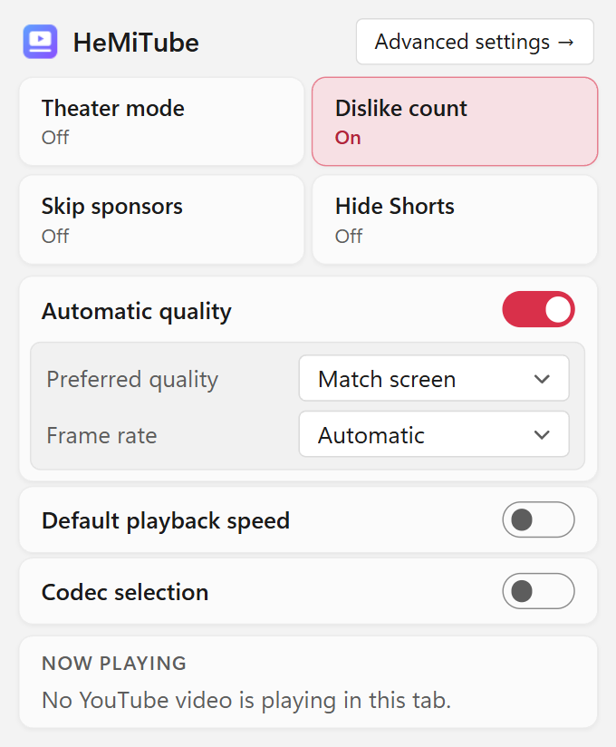
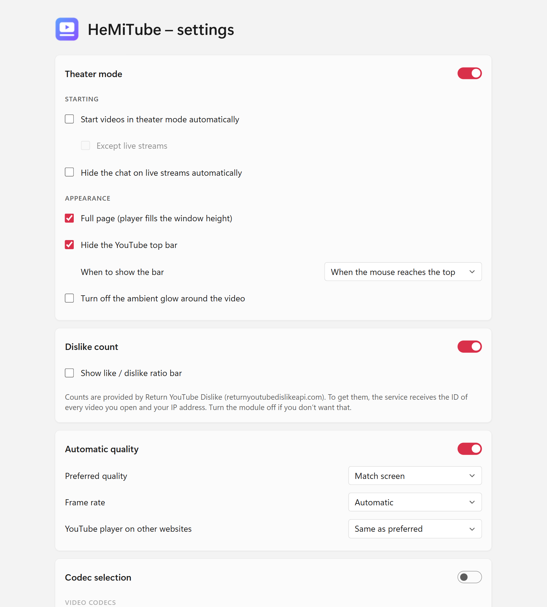

# HeMiTube

A browser extension that makes YouTube calmer and more comfortable: a real theater mode, the dislike count back,
the quality and codecs you want, and no Shorts if you like. For Chromium browsers (Chrome, Edge, Brave, Opera, Vivaldi), Manifest V3.
English and Czech.

<p>
<picture>
  <source media="(prefers-color-scheme: dark)" srcset="screenshots/popup-dark.png">
  
</picture>
</p>

## What it does

| | |
|---|---|
| **Theater mode** | The player across the whole page (the video keeps its shape, black bars around it), the YouTube top bar hidden – shown when the mouse reaches the top or when you scroll. Optionally turned on by itself for every video (live streams can be left out). Optionally without the ambient glow, and the live chat folded. |
| **Dislike count** | The number of dislikes next to the like button, also on Shorts, optionally a like / dislike ratio bar. From [Return YouTube Dislike](https://returnyoutubedislike.com) – read only, nothing is ever voted. |
| **Automatic quality** | By default the smallest quality that fills your screen (never more than the display can show), or a fixed one; a 30 FPS limit; its own quality for YouTube videos on other websites. A quality you pick by hand stays until the end of the video. |
| *Codec selection* | Which video (AV1, VP9, H.264) and audio codecs (Opus, AAC) YouTube may use, and in what order – for older or weaker hardware. |
| *Hide Shorts* | Shorts gone from the home page, subscriptions, search, recommendations, the menu and channels; links to Shorts can open in the normal player. |
| *Default playback speed* | Every video at your speed (0.75× – 2×), music and live streams at normal speed. |
| *Skip sponsors* | Sponsored and other marked parts skipped, from [SponsorBlock](https://sponsor.ajay.app) – you choose which kinds. |
| *Hide* | End screens, info cards, recommended videos, the recommendations on the home page, comments – each on its own. |
| *Loop* | The whole video, or a part from A to B, by keyboard shortcuts. |
| *Keyboard shortcuts* | Theater mode, the top bar, a screenshot of the video (PNG in full resolution), the loop – no keys set by default, so nothing collides. |

*In italics:* optional, off until you turn them on. Quick settings are in the popup, everything in the settings page:

<picture>
  <source media="(prefers-color-scheme: dark)" srcset="screenshots/settings-dark.png">
  
</picture>

## Install

HeMiTube is not in the Chrome Web Store (yet), so the browser loads it as an unpacked extension:

1. Download **HeMiTube.zip** from the [latest release](https://github.com/Hemal1k/HeMiTube/releases/latest) and unpack it into a new, empty folder that stays (or let [HeMi Launcher](https://github.com/Hemal1k/HeMiLauncher) do it – it also keeps it up to date).
   To check the download (optional), run `Get-FileHash HeMiTube.zip` in PowerShell – the hash must match the one in
   SHA256SUMS.txt of the same release.
2. Open the extensions page of your browser: `chrome://extensions`, `edge://extensions`, `brave://extensions`, `opera://extensions` or `vivaldi://extensions`.
3. Turn on **Developer mode** (in Edge the switch is in the left pane, in Opera top right), click **Load unpacked** and choose the folder.

After an update, delete the old files in the folder, unpack the new zip there, then click ⟳ at HeMiTube on the extensions page
and reload YouTube (HeMi Launcher does all of this except ⟳ for you).

## Privacy

No analytics, no telemetry, no remote code. HeMiTube asks only for `storage` and for
`returnyoutubedislikeapi.com` (the dislike counts); it runs only on `youtube.com` and `youtube-nocookie.com`.

- **Dislike count:** to get a number, Return YouTube Dislike receives the ID of the video and your IP address. Turn the module off if you don't want that.
- **Skip sponsors:** the browser asks for access to `sponsor.ajay.app` only when you turn it on. Only the first 4 characters of a SHA-256 hash of the video ID are sent, so the server does not learn exactly which video you watch.
- The settings are saved in your browser's sync storage and can be exported and imported as JSON.

## Known limits

- A change of the codecs or of the 30 FPS limit takes effect after reloading the YouTube page (the popup offers it).
- YouTube picks the codec itself; an order can only be enforced by blocking the codecs before it.
- The player API YouTube uses for quality is unofficial; when it does not take, the quality menu is used once per video (it can flicker briefly).
- Mobile YouTube (`m.youtube.com`), YouTube Music and Studio are not supported.
- The Shorts filter in search and the Shorts menu item are recognized by the name “Shorts” – in languages where YouTube calls them differently, they stay.
- Dislike counts are an estimate of Return YouTube Dislike, not official YouTube data.

## For developers

Node.js 20 or newer.

```bash
npm install        # the development tools (pinned in package-lock.json)
npm run build      # dist/ – the extension, checked by scripts/verify-dist.mjs
npm run watch      # build on every change
npm test           # unit tests (node --test)
npm run lint       # ESLint
npm run e2e        # end-to-end test in Brave on live YouTube, with a temporary profile (BROWSER_PATH for another browser)
npm run package    # release/hemitube-<version>.zip
npm run icons      # the icons
npm run screenshots  # the pictures of this README
```

| Folder | |
|---|---|
| `src/main-world/` | Runs in the page itself at `document_start`: the codec filter and the YouTube player API. |
| `src/content/` | The content script: theater mode, dislikes, quality, speed, SponsorBlock, Shorts, hiding, loop, screenshot. |
| `src/background/` | The service worker: the Return YouTube Dislike and SponsorBlock requests with their cache, the shortcuts. |
| `src/shared/` | Settings, **all YouTube selectors** (`selectors.js` – the place to fix when YouTube changes), pure logic, i18n, the theme. |
| `src/popup/`, `src/options/` | The popup and the settings page. |
| `_locales/` | English and Czech texts. |
| `tests/` | Unit tests and the end-to-end test (`tests/e2e`, Chrome DevTools Protocol). |

A release (`release.ps1`, run by the GitHub workflow) attaches HeMiTube.zip and its SHA-256 checksum.

## Credits

Written from scratch; the ideas come from studying Return YouTube Dislike, YouTube Auto HD + FPS, enhanced-h264ify and
Better YouTube Theatre Mode – no code of theirs is included. Sponsor segments: SponsorBlock (data CC BY-NC-SA 4.0).

MIT License – see [LICENSE](LICENSE).
